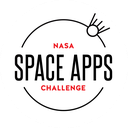

 &nbsp; 

# AstroNav Console – Desktop Dashboard

**NASA Space Apps Challenge 2026** · Challenge: *Create Health Monitoring Software for Astronauts on Space Missions*
Team AstroNav (solo) · Amsterdam (virtual) · by [YoupSpace](https://youpspace.com)

A desktop console in the style of an ISS caution-and-warning panel. It receives the telemetry from the AstroNav wrist station over Bluetooth Low Energy and turns it into live values, trends and concrete advice for the astronaut.

| Repo | What |
|---|---|
| [SpaceApps2026-AstroNav-Firmware](https://github.com/youptheking/SpaceApps2026-AstroNav-Firmware) | Wrist station: PCB, sensors, firmware, BLE protocol |
| **SpaceApps2026-AstroNav-Dashboard** (this repo) | Desktop console |

> Separate from the other AstroNav projects (AstroNav-Nano and related repos).

## Features

- **Connect and unlock** the watch with the 6-digit code on its screen, automatic reconnect
- **Caution & warning lamps** per parameter, with ISS-style classes. Mute the sound per lamp; the lamp stays lit.
- **Vitals:** live ECG trace, heart rate (ECG and optical), SpO2, HRV against a personal baseline, skin-temperature trend
- **Signal quality first:** optical values during movement or weak pulse are not shown as real, RR data is ignored when the ECG is poor, short dropouts hold the last good value
- **Cabin air:** 1-hour ppCO2 against the **NASA-STD-3001 limit of 3 mmHg** and the 2.5 mmHg target, pressure trend, temperature, humidity
- **Body map** with what changes in space and when to act, plus an ECG leads tab that opens by itself when an electrode comes loose
- **What to do:** the most urgent advice right now, sent to the wrist with one click
- **Event log** with who raised and who handled each alert
- **Simulated values are always labelled:** the watch says which values are simulated, the console marks them "Sim"
- **Demo mode:** a simulated watch on the laptop that sends the same packets and plays a 5-minute story (stress builds, CO2 rises, an electrode comes loose, the breathing break works)
- **Station time:** everything in GMT, like on board
- **NASA hazards:** the five hazards of NASA's Human Research Program, with what AstroNav monitors for each and the related HRP risks; radiation is honestly marked "Not measured"
- **7 days:** the watch stores a summary every minute; the console fetches it over BLE and shows hourly charts (heart rate, lowest SpO2, ppCO2 against the NASA limit, activity) and a table per day
- **Daily check-in:** sleep, mood, optional blood pressure and glucose, stored per crew member and day
- **Crew selector:** the real wrist station plus demo crew members on pretend watches
- **Dummy data is always marked:** a notice under the top bar says when the screen shows example values, a demo or a demo crew member

## Stack

Tauri 2 · Rust (`btleplug`) for BLE and packet parsing · React + TypeScript · Vite · Vitest

```
Wrist station (ESP32-S3)  --BLE-->  Rust backend (Tauri)  -->  React console
```

## Run

```
npm install
npm run tauri dev
```

Tests: `npm test`. Without the watch, turn on **Demo** in the top bar.

## NASA resources

- **NASA-STD-3001 Vol. 2, Rev. F, [V2 6004]:** 1-hour average ppCO2 at or below 3 mmHg, shown as a limit line on the CO2 chart
- **[V2 6022]:** alert the crew locally and remotely; the console is the remote half, the watch the local half
- **[V2 6012]:** cabin temperature and humidity limits
- **NASA OCHMO technical briefs** (CO2, ECLSS, Behavioral Health) for the reasoning behind the limits and why stress is monitored

Physiological limits (SpO2, heart rate, stress) come from the WHO Pulse Oximetry Training Manual or are our own choice. The console gives advice, not a diagnosis.

## Limitations

- One real wrist station; the other crew members are demo crew on pretend watches
- The check-in is stored on this laptop only
- No radiation sensor (CSA's CANS dosimeter is the logical next step)
- No blood-pressure trend (pulse transit time) yet; the watch already sends ECG and PPG on one clock

## Use of AI

Per the Space Apps rules, I disclose where AI ("SI") was used.

The idea and concept are my own. Claude (Anthropic) was used to research parts, look up limits in NASA-STD-3001, draft documentation, and write a significant portion of the code from my own design. PCB design, milling, soldering, the case and all testing on the real watch were done by hand.

---

Made by [YoupSpace](https://youpspace.com) for NASA Space Apps 2026.
